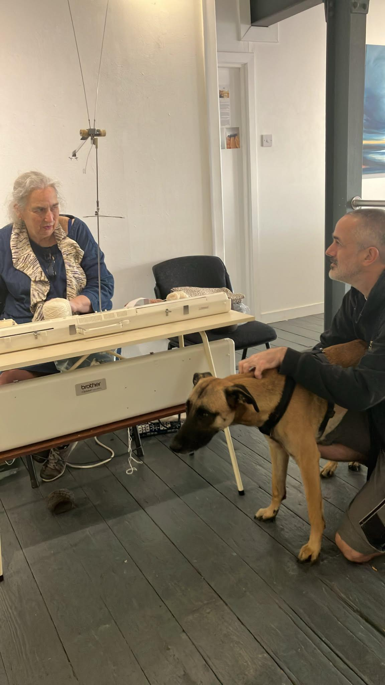

# Rule 110 Knitting Computer

A few years ago I went to a talk by [Sydney Padua](https://en.wikipedia.org/wiki/Sydney_Padua), about [her book](https://en.wikipedia.org/wiki/The_Thrilling_Adventures_of_Lovelace_and_Babbage) and [the project](https://blog.plan28.org/) to build [Charles Babbage](https://en.wikipedia.org/wiki/Charles_Babbage)'s [Analytical Engine](https://en.wikipedia.org/wiki/Analytical_engine). She showed [some 3D animations](https://www.youtube.com/watch?v=gODpK9dTEWc) she had made of some parts of it. It was inspiring stuff and got me interested in the idea of making a mechanical computer.

 
<small>Image: A Lego model of two numbered wheels, with cogs underneath showing that when you rotate one they both rotate.</small>

Then recently I went to an exhibition by [Madeleine Shepherd](https://www.madeleineshepherd.co.uk/) where she showed some of her [rule 30 cellular automata knitting](https://www.madeleineshepherd.co.uk/gallery_779383.html).

  
<small>Images: (left) Madeleine Shepherd demonstrating her work on a knitting machine. (right) Some of her knitted objects with the rule 30 cellular automata pattern in black and white.</small>

She was using a knitting machine, where a carriage is pulled left and right across a bed of needles. Punched cards or a computer can be used to tell the machine which color to use for each stitch.

And I'm thinking:

<i>These cellular automata are simple systems, could we implement them on the knitting machine with some cogs or something?

Furthermore, if we used one of the universal cellular automata, it would actually become a full computer in its own right!</i>

And thus the Rule 110 Knitting Computer project was born.

### Pegs:

Data is a stored on a binary tape as peg positions.

  
<small>Image: A tape of pegs. Most are in the 0 position (down). One of them is in the 1 position (up).</small>

These pegs are designed to have a little friction, so that they don't vibrate out of position.

### Sensors:

### Logic components:

### Actuators:

### Updaters:

