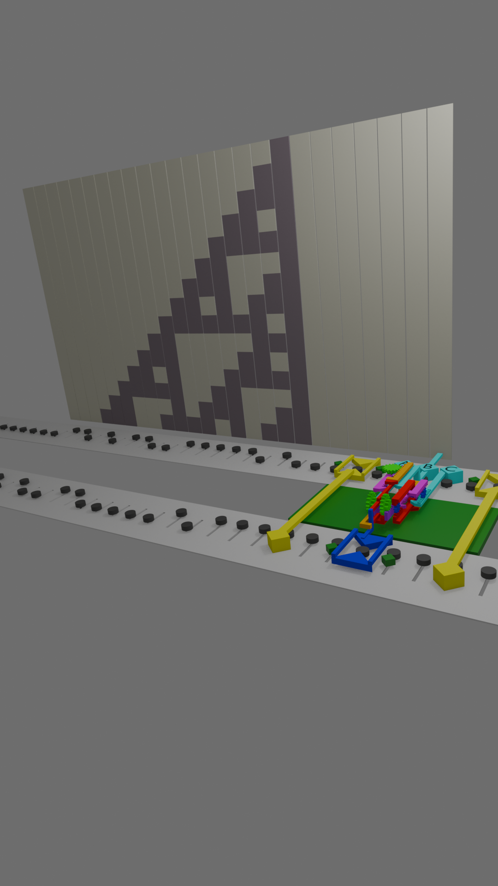
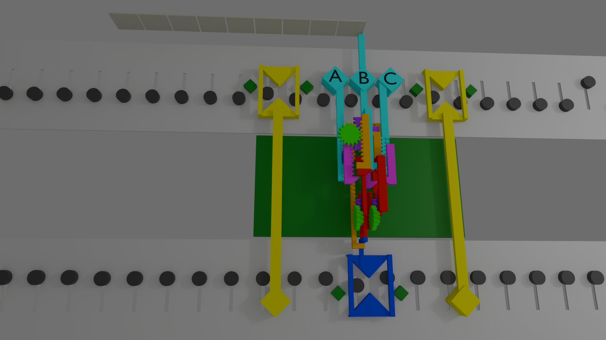
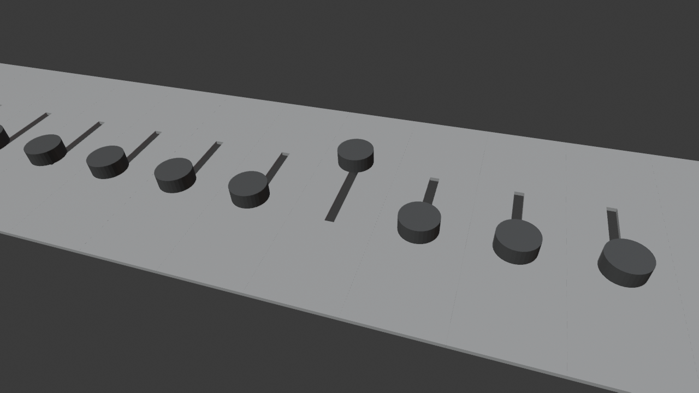
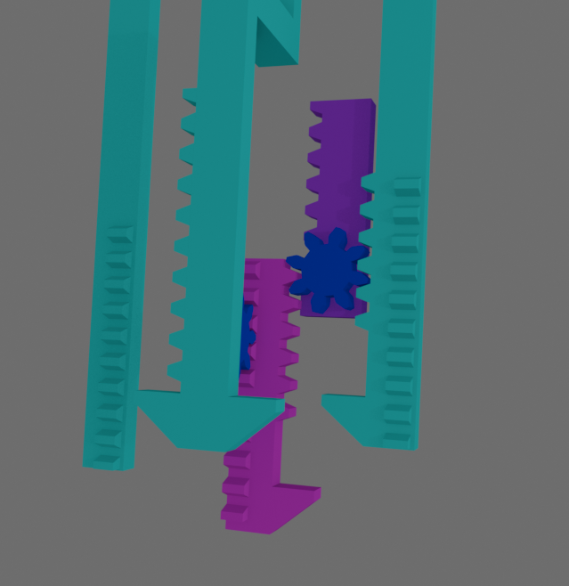
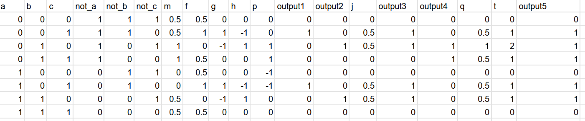
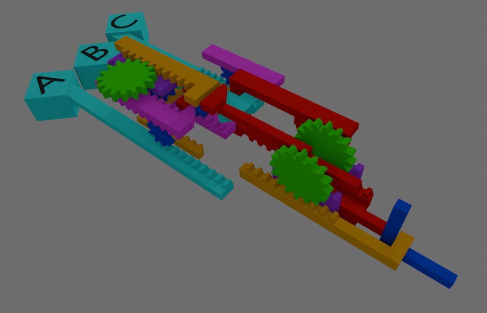
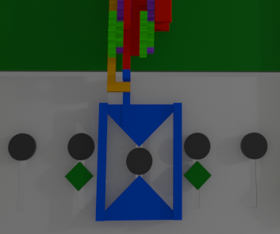
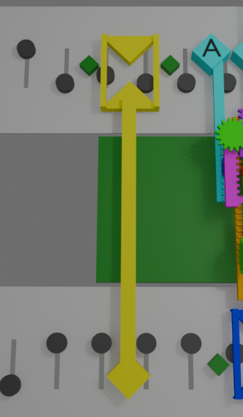
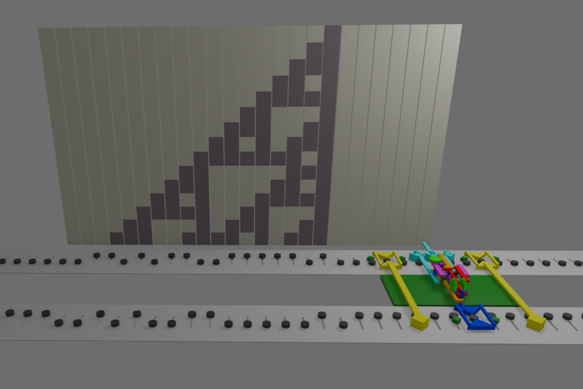

Contents: [Background](#background) - [Operation](#operation) - [FAQs](#faqs) - [License](#license)

# Mechanical Computer

Videos: (click to play)

<a href="https://www.youtube.com/shorts/iIKQuGVjefM"></a>
<a href="https://www.youtube.com/watch?v=TBCexW6co-U"></a>

Discussion: https://mathstodon.xyz/@timhutton/117650488083356414

## Background:

A few years ago I went to a talk by [Sydney Padua](https://en.wikipedia.org/wiki/Sydney_Padua), about [her book](https://en.wikipedia.org/wiki/The_Thrilling_Adventures_of_Lovelace_and_Babbage) and [the project](https://blog.plan28.org/) to build [Charles Babbage](https://en.wikipedia.org/wiki/Charles_Babbage)'s [Analytical Engine](https://en.wikipedia.org/wiki/Analytical_engine). She showed [some 3D animations](https://www.youtube.com/watch?v=gODpK9dTEWc) she had made of some parts of it. It was inspiring stuff and got me interested in the idea of making a mechanical computer. But Babbage's machine is enormous and may never be built!

<p style="margin-left:5%"><br>
<i>Image: A Lego model of part of the Difference Engine I made for a workshop. It has two numbered wheels, with cogs underneath showing that when you rotate one they both rotate. You can interpret their movement as adding two numbers together.</i>

In 2010 I [made a computer](https://timhutton.github.io/2010/03/10/30984.html) in a 2D cellular automata, based on a design from 1968. But it was [enormous](https://timhutton.github.io/2011/11/01/35566.html) and may never be run to completion!

More recently (October 2026) I went to an exhibition by [Madeleine Shepherd](https://www.madeleineshepherd.co.uk/) where she showed some of her [cellular automata knitting](https://www.madeleineshepherd.co.uk/gallery_779383.html).

<p style="margin-left:5%"> <br>
<i>Images: Madeleine Shepherd demonstrating her work on a knitting machine.</i>

She was using a knitting machine which if you haven't seen one is a device of some complexity. A carriage is pulled left and right across a bed of needles. Punched cards or a computer can be used to tell the machine which color to use for each stitch.

And I'm thinking:

<p style="margin-left:5%"><i>These cellular automata are simple systems, could we implement them on the knitting machine with some cogs or something?

<p style="margin-left:5%">Furthermore, if we used one of the universal cellular automata, it would actually become a full computer in its own right!</i>

And thus the Rule 110 Knitting Computer project was born.

## Operation:

### Pegs:

[Rule 110](https://mathworld.wolfram.com/Rule110.html) operates on a binary tape: 00000011010111011101111101010110000000

At each step the new value at a position is given by the current value and those of its neighbors:

| Current pattern|111|110|101|100|011|010|001|000|
|----|----|----|----|----|----|----|----|----|
| New state for center cell|0|1|1|0|1|1|1|0|

Starting from 000000010000000 (a single black cell) we get this pattern:

<p style="margin-left:5%"><br>
<i>Image: The output of rule 110 starting from a single cell in state 1.</i>

In our implementation we use sliding pegs as the data tape:

<p style="margin-left:5%"> <br>
<i>Image: A tape of pegs. Most are in the 0 position (down). One of them is in the 1 position (up).</i>

These pegs are designed to have a little friction, so that they don't vibrate out of position. But not too much, as we need to push them around.

### Sensors:

The pegs are designed to work together with the sensors, which are little diamond shapes attached to rods. The rods are constrained to only move along their length, so as the carriage comes along the sensors translate the 0,1 position of a peg into a vertical motion of the rod.

https://github.com/user-attachments/assets/a61cf8b2-bdf8-4a0e-8b16-e914046d93ee

&nbsp;

<i>Images, video: Sensors moving past fixed pegs. Firstly one sensor, then a group of three sensors reading from three neighboring pegs.</i>

The pegs cannot move beyond their end stops, which gives the sensors something to push against. This is what powers the mechanism.

Note that the sensors don't normally alter the peg positions but if the pegs are slightly out of position then the sensors will nudge them back. If the pegs are dramatically out of position then the sensor could go to the wrong side, or get jammed.

### Logic components:

Following the work of [Anthony Zhang](https://anthony-zhang.me/blog/rod-logic/) we make use of components that perform the following operations:

#### Invert:

<br>
<i>Image: A dark blue cog on a fixed axis inverts one rod (light blue) into another (magenta).</i>

By adding a gear with a fixed axis between two rods as shown we can perform the following operation: b = 1 - a

Note that the values here are in reference to the direction of the first rod.

#### Average:

<br>
<i>Image: A dark blue cog with its axis mounted on a dark purple rod.</i>

By mounting a cog on a moving rod we can take the average of two rods: c = (a + b) / 2

#### Multiply:

<br>
<i>Image: A green cog with two radii.</i>

A gear with two radii can be used to multiply up the movement of a rod: b = a * 2

Of course it could also divide by 2, or apply any other factor.

#### Add/subtract:

It is actually trivial to add or subtract a value - simply make the rod longer or shorter. You'll see the occasional `-1` mentioned below which is there to make the math work but these are just absorbed in the placement of the rods and don't need extra components.

### Min/max:

<br>
<i>Image: A red rod is pushed by an orange rod, and held back by a light blue rod and a magenta rod.</i>

Rods can push/pull each other, applying a min/max operation. In the example shown: d = max(min(a,b), c)

### Combining logic operations for rule 110:

One simple way to express the 110 rule is: rule110(A, B, C) = (not(A) AND B) OR (B XOR C)

With our gears we can achieve this as follows:

```
not_a = 1 - a
not_b = 1 - b
not_c = 1 - c
f = (c + not_b) / 2
g = f * 2 - 1 = c + not_b - 1 (using gear E)
h = -g (using the opposite side of gear E)
output1 = min(min(c, not_b), g)  # pushed forward by g, pulled back by c and not_b = c AND not_b
output2 = min(min(not_c, b), h)  # pushed forward by h, pulled back by not_c and b = not_c AND b
m = (b + not_a) / 2
p = m * 2 - 1 (using gear N)
j = (output1 + output2) / 2
output3 = j * 2 = b XOR c (using gear K)
output4 = min(min(b, not_a), p)  # pushed forward by p, pulled back by b and not_a = not_a AND b
q = (output3 + output4) / 2 (q is the gear, r is the rod)
t = q * 2 (using gear S)
output5 = min(max(output3, output4), t)  # pulled back by t, pushed forward by output3 and ouput4
        = (b XOR c) OR (not_a AND b) = rule110

Total: 20 rods (a, b, c, not_a, not_b, not_c, f, g, h, output1, output2, m, p, j, output3, output4, q, t, r, output5)
       11 gears (invert_A, invert_C, invert_C, F_gear, E, M_gear, N, J_gear, K, Q, S)
```

The names of components here correspond to the objects in the Blender file which you can download to explore.

To check the logic, see `rule110_components_table.ods` which computes the truth table:



Note that our mechanism isn't a simple composition of AND, OR and NOT gates - we have saved a few gears and rods. And it might be possible to use still fewer moving parts.

The whole mechanism looks like this:

<br>
<i>Image: Cogs and rods in different colors, computing the 110 rule from the values on three sensors.</i>

The three sensors A, B, C run along the pegs as seen before. At the moment when each is directly aligned with a peg the output rod (dark blue) is in the correct position for the output of rule 110.

### Actuators:

To store the output we push a peg. But we can't write it straight back to the input tape because this would affect the computation for the next step when the carriage moves along. So we write it to a separate tape for now, using actuators:

<br>
<i>Image: An actuator (dark blue) pushing a peg.</i>

This device physically pushes the peg one way or the other. Due to the way the sensors work, the range of movement isn't the same as the full range of movement of the pegs, so we use little correctors (dark green) to nudge the pegs the remaining distance. These correctors are fixed to the carriage body (connections not shown) and don't move with the actuator.

Instead of using correctors we could use a gear to extend the movement of the actuators. This would work but would mean having more moving parts.

### Updaters:

Having written the output value to a peg in the second tape, we update the first tape after the machine has passed:

<br>
<i>Image: An updater (yellow) senses a peg in the bottom strip and pushes a peg in the top strip.</i>

We directly connect a sensor to an actuator using a rod as shown.

Note that we need two of these, as the carriage must work when travelling in either direction. The updater on the leading side doesn't do any harm since the tapes are the same at that point.

So by moving the carriage back and forth across a length of pegs we run the rule 110 cellular automata:

<br>
<i>Image: The machine after a few passes has computed a few iterations of the rule.</i>

Note that the second tape has inverted pegs compared to the first one. This is just a quirk of how the sensors and actuators work.

With the two updaters there is a total of 33 moving parts (22 rods, 11 gears) not counting the pegs.

### Output:

The pattern shown in the background of the image above is a visual placeholder for the output of the machine. The idea is that this will be knitting, which would actually hang down in the front. We haven't worked out the details of the yarn selector but it would be controlled by sensor B, as shown with a little rod in the above image.

## FAQs:

**Q:** What stage is this project at?<br>
**A:** The design stage. A sketch of the machine in action has been animated but lots of details are missing: support structures, output mechanism.

**Q:** Can I 3D print the files?<br>
**A:** No not yet! Lots of work will be needed to add the support structures that will hold the rods and gears in the right place. Much experimentation is needed. Please let me know if you want to try!

**Q:** Will the machine work?<br>
**A:** Not proven. There might be too much friction. Anthony Zhang showed that his components work but the sensor-peg interaction in particular is unknown.

**Q:** How will the machine produce knitting?<br>
**A:** Not designed yet. I have hope that we can make it work - in theory we just need to hold the right yarn in the right place at the right time. See the [videos by Sparks Curiosity](https://www.youtube.com/playlist?list=PLWDnfcUpk7PLQRvfuGytMauK_sR6CEwI9) for more about how knitting machines work. The separation of the pegs will likely need to be the same as the separation of the needles (typically 9mm or less) which could be tricky to manufacture.

**Q:** How will the boundary conditions work? What happens at each end of each row?<br>
**A:** In the current design this is unanswered, we just provide lots of pegs.

**Q:** Can we program the machine to knit any pattern we want?<br>
**A:** No. The output in the current design is simply the output of the rule 110 cellular automata. It's Turing-complete so can _compute_ any output but that output is encoded in the pattern in some way, not just appearing directly on the tape.

**Q:** Can we get the machine to run rule 30 instead?<br>
**A:** With a few different gears, yes! You could swap out the 'CPU' for a different one, or even one that has switches for different behavior.

**Q:** How does this machine compare with other projects?<br>
**A:** Anthony Zhang does [some comparison](https://anthony-zhang.me/blog/rod-logic/) of his gates to historical machines. I've seen a few other projects on youtube: [1](https://www.youtube.com/watch?v=-1nbC6IfMm0), [2](https://www.youtube.com/watch?v=QKnSRw_X2w4), [3](https://www.youtube.com/watch?v=zslHoquO5zk), [4](https://www.youtube.com/watch?v=Ubc7iNZ7MV8), [5](https://www.youtube.com/watch?v=GIQDA5Gnxkc). In general they seem slow or fragile.

**Q:** Will we be able to use the machine to compute something useful?<br>
**A:** No. Running rule 110 isn't an efficient way to compute anything. Even the simplest programs would need tens of thousands or millions of pegs. This project is more of a proof of concept, as a demonstration of a simple computer.

**Q:** What are the next steps?<br>
**A:** Let me know if you think we should actually try to build this thing. We would need to add the support stuctures, make some test components, and design the knitting bits.

## License:

The `rule_110.blend` file is available under CC BY-NC-SA 4.0 (https://creativecommons.org/licenses/by-nc-sa/4.0/) as work derived from that of Anthony Zhang: https://anthony-zhang.me/blog/rod-logic/

The Python scripts are available under GPL3, as work derived from the Blender Python API: https://www.blender.org/about/license/

All other files are available under CC BY-NC-SA 4.0.
