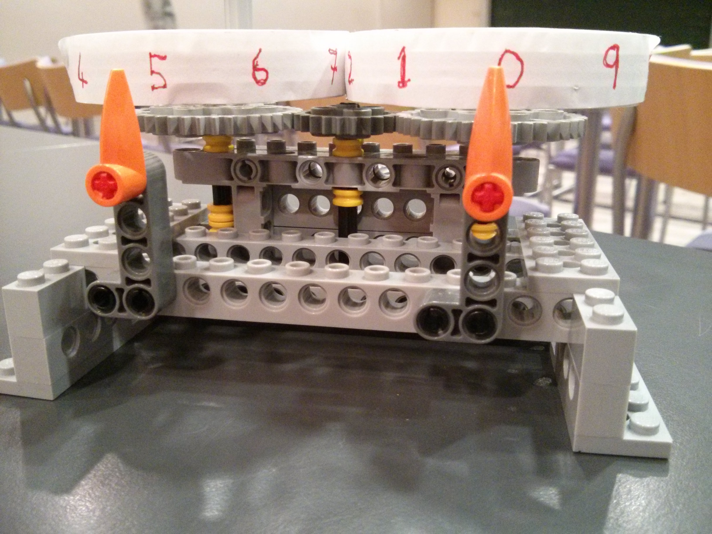
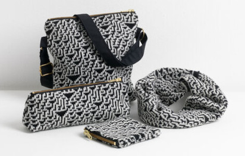
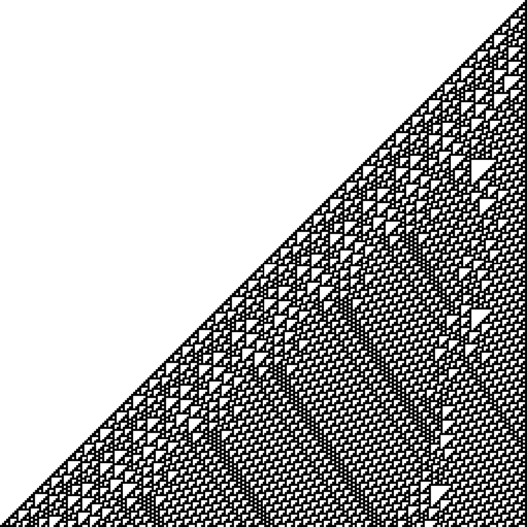
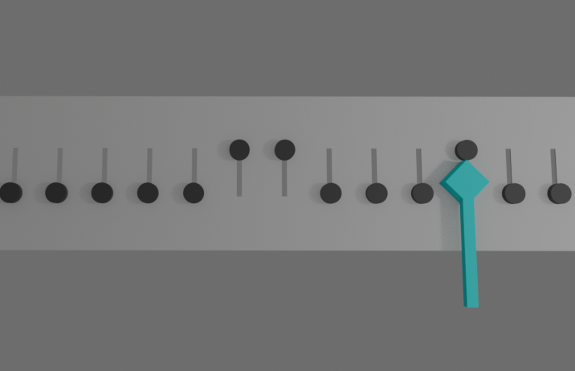
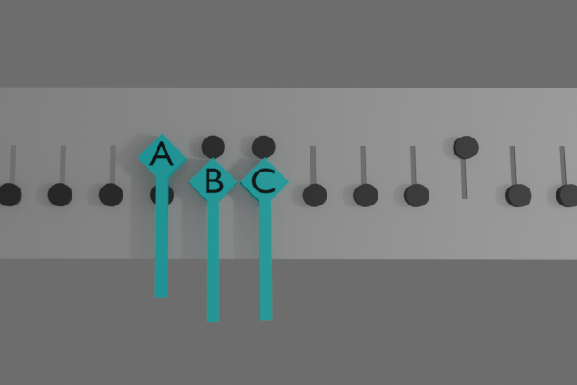
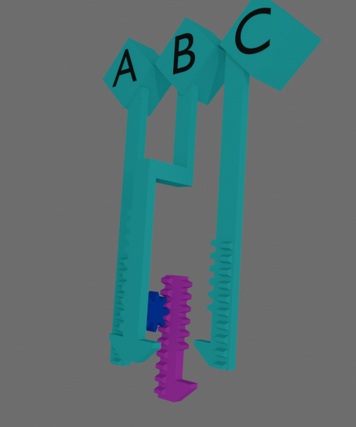
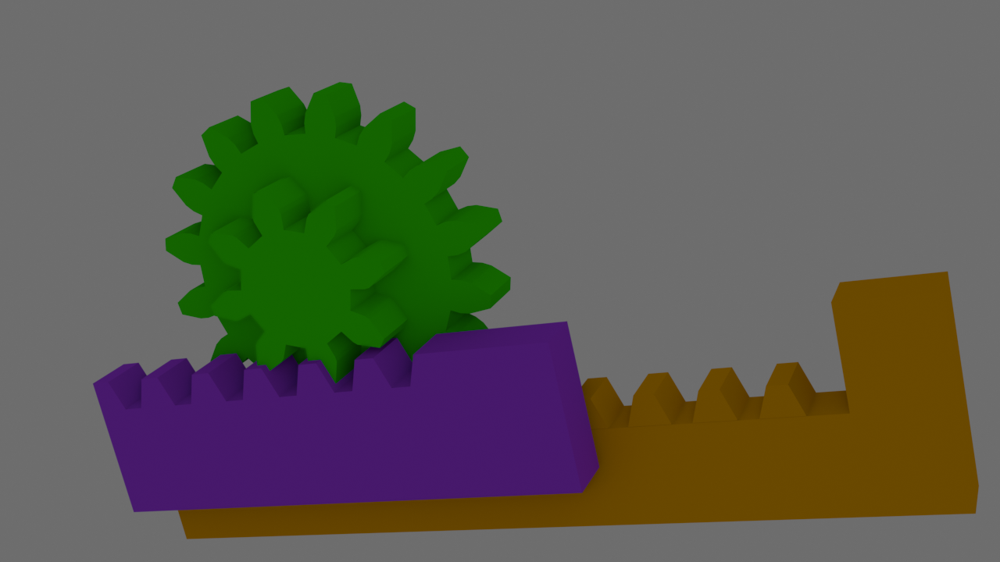
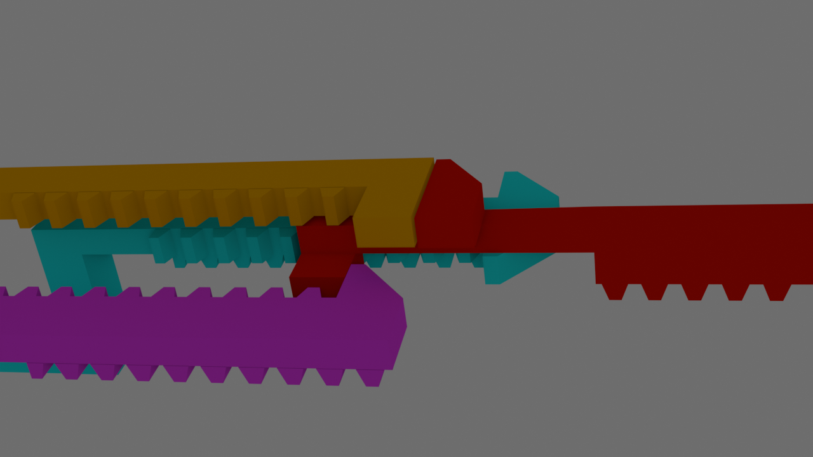

# Rule 110 Knitting Computer

[License](#license)

## About

A few years ago I went to a talk by [Sydney Padua](https://en.wikipedia.org/wiki/Sydney_Padua), about [her book](https://en.wikipedia.org/wiki/The_Thrilling_Adventures_of_Lovelace_and_Babbage) and [the project](https://blog.plan28.org/) to build [Charles Babbage](https://en.wikipedia.org/wiki/Charles_Babbage)'s [Analytical Engine](https://en.wikipedia.org/wiki/Analytical_engine). She showed [some 3D animations](https://www.youtube.com/watch?v=gODpK9dTEWc) she had made of some parts of it. It was inspiring stuff and got me interested in the idea of making a mechanical computer.

 
<i>Image: A Lego model of part of the Difference Engine I made for a workshop. It has two numbered wheels, with cogs underneath showing that when you rotate one they both rotate. You can interpret their movement as adding two numbers together.</i>

Then recently (October 2026) I went to an exhibition by [Madeleine Shepherd](https://www.madeleineshepherd.co.uk/) where she showed some of her [cellular automata knitting](https://www.madeleineshepherd.co.uk/gallery_779383.html).

  
<i>Images: (left) Madeleine Shepherd demonstrating her work on a knitting machine. (right) Some of her knitted objects with the rule 30 cellular automata pattern in black and white. <a href="https://www.madeleineshepherd.co.uk/photo_17119556.html">[Image source]</a></i>

She was using a knitting machine which if you haven't seen one is a device of some complexity. A carriage is pulled left and right across a bed of needles. Punched cards or a computer can be used to tell the machine which color to use for each stitch.

And I'm thinking:

<i>These cellular automata are simple systems, could we implement them on the knitting machine with some cogs or something?

Furthermore, if we used one of the universal cellular automata, it would actually become a full computer in its own right!</i>

And thus the Rule 110 Knitting Computer project was born.

### Pegs:

[Rule 110](https://mathworld.wolfram.com/Rule110.html) operates on a binary tape: 00000011010111011101111101010110000000

At each step the new value at a position is given by the current value and those of its neighbors:

| Current pattern|111|110|101|100|011|010|001|000|
|----|----|----|----|----|----|----|----|----|
| New state for center cell|0|1|1|0|1|1|1|0|

Starting from 000000010000000 (a single black cell) we get this pattern:

 
<i>Image: The output of rule 110 starting from a single cell in state 1.</i>

In our implementation we use sliding pegs as the data tape:

  
<i>Image: A tape of pegs. Most are in the 0 position (down). One of them is in the 1 position (up).</i>

These pegs are designed to have a little friction, so that they don't vibrate out of position. But not too much, as we need to push them around.

### Sensors:

The pegs are designed to work together with the sensors, which are little diamond shapes attached to rods. The rods are constrained to only move along their length, so as the carriage comes along the sensors translate the 0,1 position of a peg into a vertical motion of the rod.

https://github.com/user-attachments/assets/a61cf8b2-bdf8-4a0e-8b16-e914046d93ee

&nbsp;

<i>Images, video: Sensors moving past fixed pegs. Firstly one sensor, then a group of three sensors reading from three neighboring pegs.</i>

The sensors should work whichever position the peg is in. The pegs cannot move beyond their end stops, which gives the sensors something to push against. Note that the sensors don't normally alter the peg positions.

If the pegs are slightly out of position then the sensors will nudge them back. If the pegs are dramatically out of position then the sensor could go to the wrong side, or get jammed.

### Logic components:

Following the work of [Anthony Zhang](https://anthony-zhang.me/blog/rod-logic/) we make use of components that perform the following operations:

#### Invert:

 
<i>Image: A dark blue cog on a fixed axis inverts one rod (light blue) into another (magenta).</i>

#### Average:

 
<i>Image: A dark blue cog with its access mounted on a dark purple rod.</i>

#### Multiply:

 
<i>Image: A green cog with two radii.</i>

### Min/max:

 
<i>Image: A red rod is pushed by an orange rod, and held back by a light blue rod and a magenta rod.</i>

### Actuators:

### Updaters:

## License:

The `rule_110.blend` file is available under CC BY-NC-SA 4.0 (https://creativecommons.org/licenses/by-nc-sa/4.0/) as work derived from that of Anthony Zhang: https://anthony-zhang.me/blog/rod-logic/

Other `.blend` files are also available under CC BY-NC-SA 4.0.

Python scripts available under GPL3, as work derived from the Blender Python API: https://www.blender.org/about/license/
